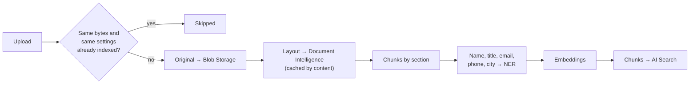
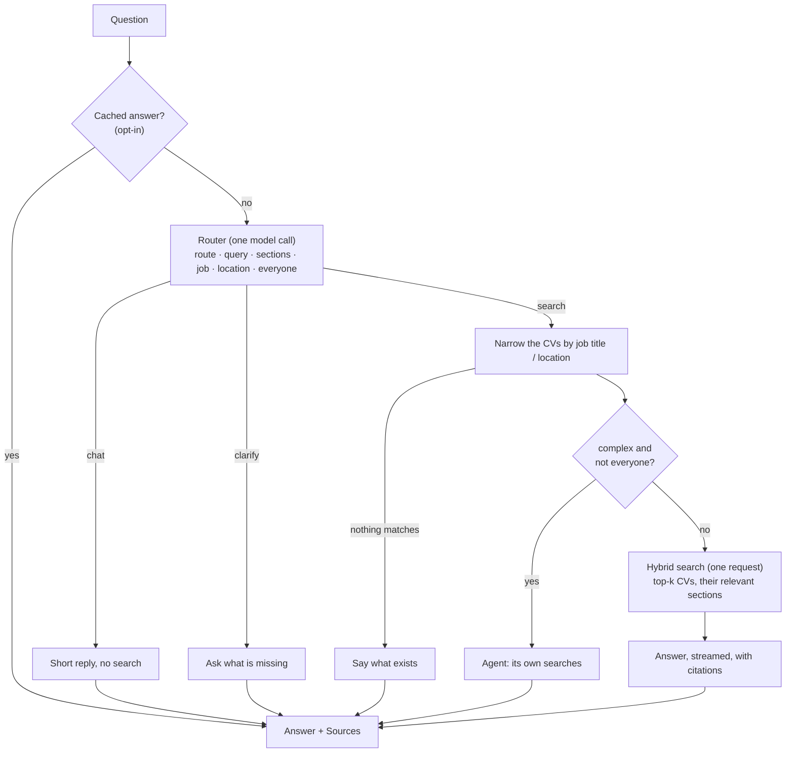

<div align="center">


# CV Lens · Chat with your CVs

**Upload a pile of CVs, then just ask questions about them.**

Every answer comes only from the uploaded CVs, is written in the language you asked in, and cites the CV and page behind each claim.


</div>

---

- **Chat**: ask about one person or compare everyone; follow-ups work; limit the chat to chosen CVs.
- **Candidates**: a table of name, job title, location and email read from each CV; pick candidates to compare or chat with.
- **Library**: upload, process (in parallel, with live status), re-index and delete CVs.
- **Accounts**: every user has their own CVs, search index and chats; nothing is shared between users.

It runs on Azure (Blob Storage, AI Search, Document Intelligence, OpenAI) and a small Postgres database for accounts and chats.

[Quick start](#quick-start) · [Configuration](#configuration) · [How it works](#how-it-works) · [Security](#security-and-privacy) ·
[Using the app](#using-the-app) · [Project layout](#project-layout) · [Troubleshooting](#troubleshooting)

---

## Quick start

You need an Azure account with these resources (their names and keys go into `.env`):

| Azure resource | Used for | Notes |
|---|---|---|
| Blob Storage | The original CV files, one private container per user | A connection string |
| AI Search | The searchable chunks, one index per user | Basic tier or above (Free works without the semantic ranker). Basic allows 15 indexes, hence the default cap of 15 users |
| Document Intelligence | The layout of each PDF or DOCX: reading order, tables, headings, OCR for scans | Endpoint and key |
| OpenAI | A chat deployment, an embedding deployment, and optionally a small cheap chat deployment that names chats | Deployment names, not model names |

### With Docker (nothing else to install)

```bash
cp .env.example .env        # then fill in your Azure values
docker compose up --build
```

Open <http://localhost:8501>, create an account, go to **Library**, upload CVs and press **Process CVs**.

The image already contains the model that reads each candidate's name, title, email, phone and city (about 1.5 GB), so the
app never downloads anything when it runs and the first CV is not slowed down. The first build takes a few minutes because
it downloads PyTorch and that model once. Postgres starts with the app; its data and the extraction cache live in Docker
volumes (`pgdata`, `appcache`) and survive restarts. `docker compose down -v` deletes them.

### Without Docker

Needs Python 3.11 or newer and a Postgres.

```bash
pip install -r requirements.txt
cp .env.example .env                       # fill in your Azure values
docker compose up -d postgres              # or point DATABASE_URL at your own Postgres
streamlit run app.py
```

The first CV downloads the NER model (1.5 GB) into the Hugging Face cache; opening the Library starts loading it in the
background. A GPU is used only if your PyTorch build supports it; otherwise the CPU is used.

---

## Configuration

Settings are validated when the app starts ([`cv_chat/config.py`](cv_chat/config.py)). A missing or invalid value stops the
app with one message naming every problem. Azure values come from `.env`:

| Variable | Meaning |
|---|---|
| `AZURE_STORAGE_CONNECTION_STRING` | Blob Storage connection string |
| `AZURE_STORAGE_CONTAINER` | A name **prefix** (1 to 30 lower-case letters, digits or single hyphens). Each user gets `<prefix>-<user id>` |
| `AZURE_SEARCH_ENDPOINT`, `AZURE_SEARCH_KEY` | AI Search service address and admin key |
| `AZURE_SEARCH_INDEX` | A name **prefix** (up to 90 characters, same rules). Each user gets `<prefix>-<user id>` |
| `AZURE_DOCINTEL_ENDPOINT`, `AZURE_DOCINTEL_KEY` | Document Intelligence |
| `AZURE_OPENAI_ENDPOINT`, `AZURE_OPENAI_API_KEY`, `AZURE_OPENAI_API_VERSION` | Azure OpenAI resource address (without `/openai/...`), key and API version |
| `AZURE_OPENAI_EMBEDDING_DEPLOYMENT`, `AZURE_OPENAI_CHAT_DEPLOYMENT` | Deployment names |
| `AZURE_OPENAI_SMALL_DEPLOYMENT` | Optional: a cheaper deployment that names chats. Without it a chat is named after its first question |
| `DATABASE_URL` | Postgres address (already right for the Docker setup) |

Everything else has a default and can be overridden in `.env` as `CVCHAT_<GROUP>__<NAME>`, for example
`CVCHAT_RETRIEVAL__TOP_K=10`. Account settings use `CVCHAT_ACCOUNTS_<NAME>`. The ones worth knowing:

| Setting | Default | Meaning |
|---|---|---|
| `retrieval.top_k` | 20 | CVs read for a question about everyone (a comparison, a ranking, a list) |
| `retrieval.top_k_focused` | 3 | CVs read for any other question |
| `retrieval.search_k` | 50 | Chunks fetched per search (the semantic ranker's limit) |
| `retrieval.source_chars` | 600 | A source shown in the Sources list is cut to this length |
| `chunking.max_chars` / `overlap` | 4000 / 400 | A section stays one chunk unless it is longer than this |
| `entities.labels`, `threshold` | see file | What the NER is asked for and how sure it must be (the wording matters: `city` finds places, `location` also finds universities) |
| `sections.types` | see file | Heading keywords per standard section (experience, education, skills, ...) |
| `agent.max_rounds` / `max_seconds` | 5 / 30 | Limits of the agent that handles complex questions |
| `concurrency.*` | see file | Adaptive limits for Azure OpenAI calls, a share kept free for questions while CVs are processed, calls one user may start at once, CVs processed in parallel |
| `cache.*` | see file | Sizes and lifetimes of the caches |
| `ingest.pipeline_version` | 2 | Bump after changing how a CV is processed: older CVs then show as outdated |
| `extraction.version` | 2 | Bump when what is kept from a CV changes: cached layouts of another version are deleted |
| `index.version` | 3 | Bump when the stored fields change: every index is rebuilt from the stored CVs |
| `accounts.max_users` | 15 | Sign-up cap (one search index per user) |
| `accounts.min_password` | 8 | Can only be raised |
| `accounts.max_failed_attempts` / `lockout_minutes` | 5 / 15 | Limits on guessing passwords and recovery codes |

---

## How it works

### Reading a CV (Library → Process CVs)



1. **Check.** The file name is the CV's id (up to 255 bytes, no slashes). If the stored hash of the file bytes plus the
   pipeline settings matches, the CV is skipped. Re-uploading a changed file replaces the old chunks.
2. **Original first.** The file is stored before anything else, so a later failure still leaves it for **Re-index**.
3. **Layout.** Document Intelligence returns the text in reading order, tables as markdown, and which lines are headings.
   Nothing is dropped (page numbers and footers stay). The result is cached on disk by content, so re-processing does not pay again.
4. **Chunks by section.** Each section (a heading and what is under it) is one chunk that starts with its heading. Only a
   section longer than `chunking.max_chars` is split. Text before the first heading goes under *Other*.
5. **Candidate details.** A named-entity model (GLiNER) is asked, one label at a time, for name, job title, email, phone and
   city. The CV is read from the start; the first piece of text with an answer decides, a value is never replaced by a later
   one, and reading stops when all five are found. There are no patterns or word lists. Years of experience are not read.
6. **Embed and store.** Each chunk is embedded together with the file name and candidate, then uploaded. Old chunks of the
   same file are removed afterwards, so the CV is never missing from search.

CVs are processed in parallel in the background; one failing file never stops the others. **Re-process older CVs** re-indexes
only the CVs processed by an older pipeline.

### Answering a question



- **Router.** One model call classifies the message (`chat`, `simple`, `complex`, `clarify`), rewrites it to stand alone in
  English, and picks sections, a job title, a location, and whether the question is about everyone. If it fails, the raw
  question is searched: routing only improves the search and can never block an answer.
- **Filters.** A job title or location is matched against what was read from each CV (all words, case and plurals ignored).
  If nothing matches, the reply lists the job titles and locations that exist, so the question can be corrected.
- **Search.** One Azure AI Search request combines keyword search (English analyzer, boosts for names, titles and the
  routed sections), vector search and the semantic ranker. If the user asks about specific sections ("compare their
  experience"), only those sections are searched; if that finds nothing, the search repeats without the restriction.
- **What the model reads.** The best `top_k` CVs (20 for questions about everyone, 3 otherwise), and from each only the
  sections the search found, in reading order. The first search can miss CVs, so up to three more searches cover the
  rest, which lets a comparison include every candidate.
- **The agent** handles complex questions with three tools: `list_cvs` (names, titles, locations), `search_cvs` (filters:
  CVs, job title, location, sections) and `get_cv` (the outline of one CV, then only the sections asked for). It is capped
  in rounds and time and falls back to the normal flow if it fails.
- **Answer.** Streamed, in the language of the question, citing `[file name, p.N]`. If Azure's content filter refuses an
  excerpt, the app finds it by halving the list, answers from the rest and says which CV was left out.

### Keeping it fast and safe to share

- **Caches** (per user, in memory): router decisions, searches, optional final answers, chat replies, the CV list, question
  embeddings and signed file links. Anything that changes a CV clears them; a value computed while a CV changed is not stored.
- **Concurrency.** Embedding calls made while CVs are processed leave a share of the capacity free for questions. Chat calls
  have their own limit, back off when Azure answers "too many requests" and grow back, and one user can only start a few at once.
- **Self-updating index.** The index carries a marker field named after a hash of its definition. When a new version wants a
  different index (or the embedding model changed), the app deletes it, creates the new one and re-indexes the stored CVs
  in the background. The original files are never touched.
- **Idle pages do not poll.** The progress indicators check every 2 seconds only while CVs are being processed.

---

## Security and privacy

- **Isolation.** Every Azure call takes a workspace built from the logged-in user's id, which names that user's own
  container and index. Postgres queries always include the user's id.
- **CV text is untrusted.** Excerpts are wrapped in `<cv_excerpt>` tags (tags inside the text are removed), the prompts tell
  the model to treat them as data, Markdown images in answers are stripped, and everything drawn from a CV, file name or
  model is escaped.
- **Accounts.** Passwords are hashed with argon2 (never while holding a database connection). Session tokens are random and
  only their hash is stored. Five wrong passwords or recovery codes lock that email for 15 minutes, counted before the
  password is checked so parallel guesses cannot slip through (so a known email can be locked on purpose for a short
  while). Unknown emails behave like wrong passwords. A one-time recovery code, shown once, resets a forgotten password.
- **Cookie.** The session cookie cannot be `HttpOnly` (Streamlit has no way to set that) and is marked `Secure` when the app
  is reached over HTTPS. **Serve it over HTTPS** outside your own machine.
- **Secrets.** Keys come from `.env` (never committed, never copied into the Docker image) and are not printed.
- **Deleting.** Deleting a CV removes its chunks from the search index and then the file from Blob Storage. Deleting an
  account removes its CVs, index, chats and sessions.

---

## Using the app

- **Chat.** Starter questions are built from your CVs' titles and places. *Answering from* limits the chat to chosen CVs.
  Under each answer: Sources (the CVs and excerpts used, with links to the originals), thumbs up/down, copy and regenerate.
  Chats are saved; the sidebar searches, renames and deletes them.
- **Candidates.** Filter and sort the table, open the original CV, select candidates to chat with only them, or select two or
  three to compare side by side.
- **Library.** Upload PDF or DOCX files and press **Process CVs**. The status panel shows each file's stage. Select rows to
  **Re-index** (process the stored file again) or **Delete**; **Re-process older CVs** updates only outdated ones.
- **Account menu** (your email in the sidebar): log out, *Show technical details* (a Details panel under each answer with the
  route, searches, settings and timings), *Cache final answers*, clear cache, change password, a new recovery code, delete account.

---

## Project layout

```
app.py                       Streamlit entry point (login, workspace, the three views)
cv_chat/
  config.py                  validated settings: Azure values and every tunable
  account_config.py          account and database settings (needs no Azure values)
  workspace.py               one user's container and index names
  auth.py  db.py  history.py accounts and sessions, Postgres schema, saved chats
  processing/                extract (layout), chunking, sections, entities (candidate details)
  services/                  blob_storage, search_index, openai_service (limits, retries)
  rag/                       ingest, jobs (parallel queue), qa (router and answer), retrieval,
                             filters, agent, cache, trace
  ui/                        the pages, the sidebar chat list, the Details panel, styling
Dockerfile  docker-compose.yml  .env.example  requirements.txt
```

There are no automated tests in this repository.

---

## Troubleshooting

| Message or symptom | Meaning and fix |
|---|---|
| "Missing or invalid in .env: ..." | A setting is missing or out of range (the message names each one). Fix `.env` and restart |
| "Could not reach Postgres" | Start it with `docker compose up -d postgres`, or fix `DATABASE_URL` |
| "Azure OpenAI has no deployment named ..." | Use the deployment name from the portal, not the model name; check the endpoint and API version |
| "The storage container ... was deleted a moment ago" | Azure is still removing a deleted container. Wait about a minute and try again |
| A CV shows "No text found (scanned PDF?)" | The file has no readable text even after OCR |
| After an update the sidebar shows CVs being processed | The search index (or the embedding model) changed, so the app rebuilt the index and is re-indexing the stored CVs. Nothing to do |
| "Too many failed attempts" | Wait for the time in the message. Resetting the password with the recovery code clears the lock |
| Sign-ups closed | The user cap (`accounts.max_users`) is reached |
| Answers say the CVs do not contain the information | The routed sections or filters may be too narrow: ask again without naming a section, a job or a place, or choose all CVs |

Costs: each question makes one router call, one search and one answer call (a complex one makes several). Document
Intelligence is billed per page and only for new or changed files; embeddings are billed per processed CV.
